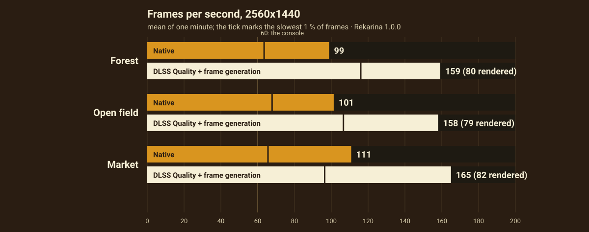
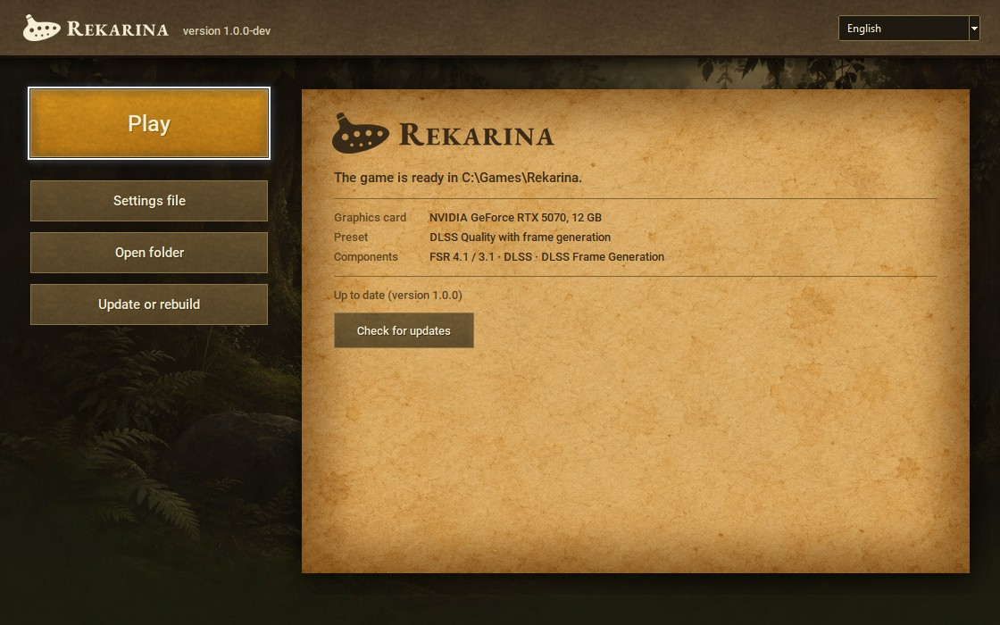
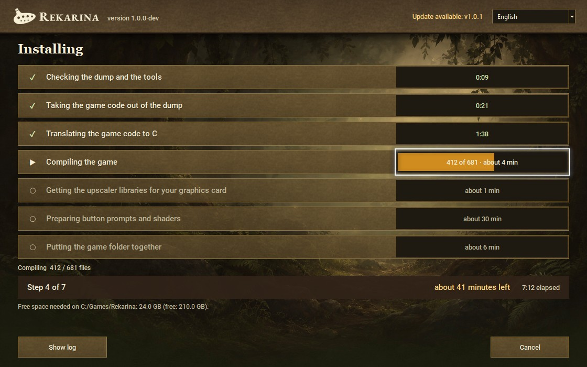

  

  <b>A native PC port</b> made by static recompilation, not emulation. 
  Built on your own PC from your own copy of the game.

  
  
  

  <a href="https://rekarina.dev">Website</a> ·
  <a href="https://discord.gg/6N8PKr9zZA">Discord</a> ·
  <a href="#install">Install</a> ·
  <a href="#performance">Performance</a> ·
  <a href="#features">Features</a> ·
  <a href="#updates">Updates</a> ·
  <a href="#known-issues">Known issues</a> ·
  <a href="#credits">Credits</a>

> [!IMPORTANT]
> **No game files are included, and none are downloaded.** You need your own legally obtained copy of the
> game, dumped from your own console as a `.nup` (base game 1.0.0 with update 1.1.1). The launcher
> builds the game from your files on your machine, so the result contains the game. It is for your own use: do not
> share it. Do not ask for game files here; issues that link or attach them are closed.

## What it is

Rekarina translates the game's ARM64 code to C ahead of time and compiles it into an ordinary x86-64 executable. The
console's graphics calls go to a Vulkan renderer written for this game, its shaders are translated once at install,
and the system services the game expects (files, audio, input, video decoding) are implemented natively. There is no
CPU emulator and no JIT at run time, which is where the frame rate comes from.

## Performance

Measured in the game itself, on one machine, with the tools in this repository (`tools/bench_oot.py`); every number is
the mean of a one-minute run, with the 1 % low beside it. "Native" is the sharp base picture at the monitor's
resolution without any upscaler; "DLSS Quality + frame generation" is DLSS Quality with DLSS Frame Generation.

  

The machine: NVIDIA GeForce RTX 5070 (12 GB, driver 610.88), AMD Ryzen 7 9700X 8-Core Processor, 62 GB of memory, Microsoft Windows 11 Pro; Rekarina 1.0.0, 2026-11-12.

How the numbers are taken

- Each location is reached by an input script: a save is loaded (the Market and the field by a map change from
  it), and the camera then turns in place, so the whole scene passes through view. The first minute holds the loading
  and is thrown away; the second is the result. The frame limit is off (240 fps is the game's own ceiling).
- Frame times come from the game's own log (`frametime:` lines): the mean rate and the rate of the slowest 1 % of
  frames. Runs that overlapped another program using the GPU are thrown away.
- With frame generation the chart shows frames **on screen**; the frames the game renders are half of that and are
  listed in [docs/performance.md](docs/performance.md) with every run's raw numbers.

Numbers from another machine are welcome: [docs/performance.md](docs/performance.md) says how to produce them.

## Features

- **Native code, not emulation**: 100+ fps where the console runs at 60, a frame limit up to 240 or the monitor's rate
- **Smooth above 60 fps**: the game's own clock follows real time, and the places where it counted frames are
  corrected (water ripples, the pick-up counter, physics steps on moving platforms, movie cutscenes)
- **A texture cache** (`tex_cache` in `rekarina.ini`, on by default): textures are converted for your GPU once and kept
  beside the game (up to 14 GB), so ground you have crossed before streams in without hitches
- **Voice acting, music and movies** as on the console: Opus voice lines in nine languages, AV1 cutscenes
- **Sharp native picture** at any 16:9 resolution, plus 21:9 and 32:9 with the camera and the interface in that shape
- **NVIDIA DLSS / DLAA and DLSS Frame Generation**, **AMD FSR 3.1** upscaling and frame generation on any GPU. The
  launcher fetches each vendor's library from its official repository for the GPU it finds; nothing of theirs is
  bundled here
- **Settings that apply while you play**: the in-game menu (Esc or F1) is drawn in the game's own menu style, with a
  live picture beside the rows, so a change to the render scale, sharpening, colour or frame limit shows at once
- **Presets by hardware**: the first settings are chosen from your GPU and its video memory, and a texture quality
  setting keeps 6 and 8 GB cards out of trouble
- **Button prompts** for Xbox, PlayStation and Switch pads, a set drawn for this port, and the keyboard and mouse:
  they change in the running game, the menu shows the chosen set as the game draws it, and the keyboard prompts
  follow the keys you bind
- **Launcher with updates**: it builds the game, shows each step with the time it takes, and installs new releases;
  the game itself tells you when one is out
- **Menu and launcher in every language the game has**: English, Russian, Japanese, German, French, Spanish, Italian,
  Dutch, Portuguese, Korean, Simplified and Traditional Chinese
- RomFS mods from a folder, HDR10 output (experimental), a performance overlay (F10), Discord Rich Presence (off by
  default)

## Requirements

| | Minimum | Recommended |
|---|---|---|
| System | Windows 10 or 11, 64-bit | Windows 11 |
| GPU | Vulkan 1.3 with mesh shaders, 6 GB | NVIDIA RTX with 8 GB or more |
| CPU | 6 cores with AVX2 | 8 cores |
| Memory | 16 GB | 32 GB |
| Disk | 30 GB free on an SSD (the game, its shader caches and the build) | |

NVIDIA RTX cards are what the port is developed and tested on. AMD and Intel GPUs start and run, with the problems
listed under [Known issues](#known-issues).

## Install

1. Download **`Rekarina.exe`** from [Releases](../../releases/latest) and start it. It is the whole launcher in one
   file: at its first start it unpacks its tools (about a minute, once) and opens.
2. Point it at the folder with your `.nup` dump and choose where the game goes.
3. Press *Start*. The launcher checks the dump, recompiles the game's code, builds the executable, fetches the
   graphics components for your GPU and prepares the shaders. The first build takes about an hour, most of it the
   shaders; each step shows how long it has left.
4. Press *Play*.

  
  

The same launcher as a folder is `Rekarina-Setup-<version>-windows.zip`, for those who would rather unpack it
themselves; start `Rekarina-Launcher.exe` in it.

Saves and settings live in the game folder and survive updates and rebuilds. Settings are in the in-game menu; every
key is also in `rekarina.ini` beside the game ([the key list](totk.ini.example) explains each). Controls:
[docs/controls.md](docs/controls.md).

## Updates

The launcher asks [rekarina.dev](https://rekarina.dev) for the newest release when it starts (GitHub when the site does
not answer), and the game asks GitHub once at its own start (one request that carries the port's version and nothing
else; *Interface > Check for updates* turns it off). When a release is out, the game shows a notice and the launcher
offers *Update*: it downloads the new setup, checks its signature against the project's release keys, rebuilds only
what changed and re-prepares the shaders, so the first minutes after an update do not stutter.

## Known issues

- **AMD GPUs: the short grass is missing.** On the one AMD GPU the port has been run on (an integrated Radeon) trees,
  bushes, ground plants and their shadows are drawn, and the carpet of short grass is not: its draws go through task
  shaders, which that driver does not survive, so the port leaves them out on AMD's Windows driver. A discrete Radeon,
  a ROG Ally and a Steam Deck have not been run: reports with a log and a screenshot are very welcome.
  [docs/oot-notes.md](docs/oot-notes.md) ("AMD") has the details.
- Intel GPUs have never been run.
- A processor without AVX2 gets a slower build of the game, chosen by the launcher; that path has not been run on such
  a machine.
- HDR10 output is experimental and off by default.
- With another program holding most of the video memory (a video editor, a second game) the frame rate collapses; the
  game says so at the top of the screen.
- The first frames after a loading screen can hitch for a quarter of a second.
- The numbers above are with the camera turning in place. Running through the field or the Market gives 73 to 80
  fps on the same machine without the texture cache, with short hitches as new ground streams in; the texture cache
  (`tex_cache = 1`, the default) brings that to about 84 fps and removes most of the hitches.
- Linux is not supported yet.

Found something else? Open an issue with the form, and attach the log (`logs\rekarina.log` beside the game), or ask
on the [Discord server](https://discord.gg/6N8PKr9zZA).

## Building from source

[docs/building.md](docs/building.md) lists the toolchain and the steps, and [docs/installer.md](docs/installer.md) the
launcher's own flow. Everything a build writes stays under `build\` and `generated\`, which git ignores; run
`python tools/check_content.py` before a commit. Pull requests are welcome: [CONTRIBUTING.md](CONTRIBUTING.md).

## Credits

Rekarina stands on **[the recompiler](https://github.com/valentderah/totk-pc-recomp)** by Valiantsin Dzerakh: its
lifter, runtime, shader translator patches and Vulkan renderer are the foundation of this port. Thank you.

It also builds on the projects below; what was taken from each, with its license, is in
[THIRD_PARTY_NOTICES.md](THIRD_PARTY_NOTICES.md).

- [LAS Recomp](https://github.com/peiikai/LASRecomp), [MacNativeGames](https://github.com/ly05010419/MacNativeGames),
  [SavageWindRecomp](https://github.com/Revivedx/SavageWindRecomp),
  [d2r-mobile](https://github.com/jhaizhou-ops/d2r-mobile) and [nxnative](https://github.com/seedds/nxnative)
- [Ryujinx](https://github.com/Ryujinx/Ryujinx), [deko3d](https://github.com/devkitPro/deko3d),
  [nup](https://github.com/a55uka/nup), [RenoDX](https://github.com/clshortfuse/renodx)
- [SDL 3](https://libsdl.org), [Dear ImGui](https://github.com/ocornut/imgui), [dav1d](https://code.videolan.org/videolan/dav1d),
  [Opus](https://opus-codec.org), [Zstandard](https://github.com/facebook/zstd),
  [Vulkan Memory Allocator](https://github.com/GPUOpen-LibrariesAndSDKs/VulkanMemoryAllocator)
- NVIDIA DLSS and Streamline, AMD FidelityFX: downloaded from their publishers at install, under their own licenses
- [Switchbrew](https://switchbrew.org) and the Switch homebrew community

## License

Rekarina is free software under the [GNU General Public License, version 3](LICENSE): you may use, change and share
it, and what you share stays under the same license, with its source. It comes with no warranty. The recompiler it is
built on and the other third-party code keep their own licenses and notices
([THIRD_PARTY_NOTICES.md](THIRD_PARTY_NOTICES.md)). The license grants nothing for the game itself.

Rekarina is an independent, non-commercial fan project, not affiliated with or endorsed by the game's publisher or
the console's maker. All trademarks belong to their owners.

Most of the code and documentation is written by AI coding agents (Claude Code) under the maintainer's direction; the
maintainer plays every build and decides what is merged. [AGENTS.md](AGENTS.md) holds the rules they work by.
