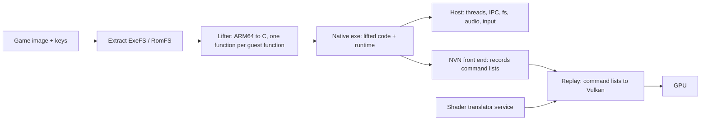
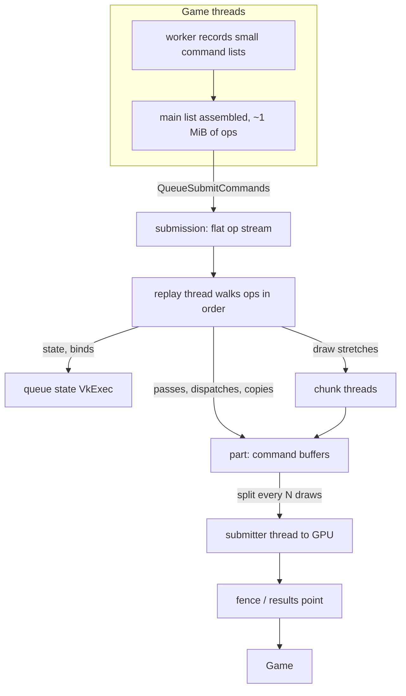

# Playbook for the next recompiler

What two ports (TotK, then OoT on the same runtime) taught, written so that a third
starts from the schemes instead of rediscovering them. The details and the measurements behind each rule are in
[architecture.md](architecture.md), [native-driver.md](native-driver.md), [oot-architecture.md](oot-architecture.md)
and the dated sections of [oot-notes.md](oot-notes.md); this file is the map.

## 1. What a port is made of

| Layer | Carries over to another game unchanged | Per game |
|---|---|---|
| Lifter (`recomp/`) | decoder, NEON lowering, register and flag locals, jump tables, differential tests | module list, version table, patches |
| Host (`runtime/`, `platform/`) | kernel objects, IPC, fs, audio, input, settings, menu | SDK functions replaced by symbol, service quirks |
| NVN front end | recording, pins, deferred binds, handle copies | NVN vs NVN2 ops, control block layout |
| Replay and Vulkan back end | everything in sections 3 to 6 | feedback rules, per-game patches of behaviour |
| Shaders | translator, cache, async builds | patches of the translator for the game's idioms |

Rule: game data never enters the repository; every derived file lives in ignored folders (`AGENTS.md`).

## 2. Order of work for a new game

1. Extract, lift, link, reach the first SVC. The differential tests against Unicorn must pass before anything else:
   a wrong instruction shows up weeks later as a physics bug.
2. Boot to the first present with a null GPU back end. Log every unimplemented SDK call by name.
3. First picture: replay in one thread, no memos, no mirrors, full barriers everywhere. Correct first.
4. Correctness tools before speed: a frame dump (targets of every pass as PNG with pass list), check modes for every
   cache, the device fault report with address labels. They pay for themselves in the first week.
5. Speed, in the order of section 7. Measure in the player's environment, not on an idle machine.
6. Stability series in the heaviest place of the game (two-minute runs, ten in a row) after every structural change.
7. Universality: a second GPU vendor early (white scenes and missing foliage were our own checks refusing pipelines,
   not driver bugs), then video memory tiers, then processor tiers.

## 3. The frame: record, replay, submit

- The game records its frame on several threads and submits one op stream; on the console the driver work happened at
  record time. A replay that translates everything at submit time on one thread is the port's bottleneck by
  construction (11.7 ms of a 13.3 ms frame in OoT's forest).
- Queue state (`VkExec`) is NVN queue state: it carries over between submissions. Everything a Vulkan command buffer
  holds itself (bound pipeline, sets, dynamic state) is separate (`B`), reset at each new command buffer.
- Parts: the frame goes to the GPU in pieces while it is still being replayed. Where the GPU decides the frame, a part
  that reaches it later is a later frame; never trade GPU feed for replay time without measuring a GPU-bound scene.
- What must stay in order on one thread: memory writes (copies, dispatches, uniform updates), waits for CPU events
  (the uniform snapshot and the mirrors are made again after them), signals that let another queue's held rest go on,
  the results point, counter reports and render conditions (their bookkeeping), image layouts.
- What does not: a stretch of binds, state and draws inside one pass. That is the unit of parallel replay
  (`vk_exec.c par_try`): the replay thread walks it for the ordered bookkeeping, chunks replay it into their own
  command buffers chained into the part, and the replay thread waits only where the part is submitted.

Numbers to expect from this scheme (OoT, 2560x1440, six threads): replay thread 11.7 to 7.8 ms in the forest, 9.7 to
6.7 ms in the field; 76 to 96 fps and 93 to 100 fps; after it both places are bounded by the GPU. 

### Design it in from day one

- Keep the executor's memos and per-command-buffer state in a context struct (or thread-local), never in file-level
  statics. Retrofitting cost sixty variables in one file and a class of races.
- Every cache gets a check mode that recomputes on a hit and stops on a difference (`TOTK_BIND_SKIP=check`,
  `TOTK_TEX_MEMO=check`). They found real bugs each time. Run all of them together after every change to the
  executor's threading, before any stability loop: a night of two-minute runs counted crashes that one minute of
  check modes explained (a function-level `static` scratch array shared by the recording threads).
- A function-level `static` buffer is a file-level static: the same rule. Grep for them in everything a draw calls.
- A cache that asks "did anything change since I last looked" is reset where a thread's view of the state is
  replaced (a worker starting from a copy), not only where the state is edited.
- A lock is taken by the lookup that needs it, not by the caller for a whole draw: a lock per draw is invisible with
  one thread and halves throughput with six.
- No shared counter is written per draw (statistics included): cache-line traffic costs more than the work.
- Objects are destroyed by deferral stamped with the submission being recorded, never with "the last submitted".
- Letting the game go on before its frame has run on the GPU (a results point) is only safe when nothing the rest of the
  frame reads is live game memory. The lost device of the heaviest place was this: buffers bound in host memory because
  their mirrors were refused, read by the lit pass while the game rewrote them. It took a day to find because the
  address the shader read had belonged to textures destroyed seconds earlier, which pointed at object lifetimes. What
  found it: a reproducer (chunk threads made it one run in two), GPU breadcrumbs per chunk, and switching the suspect
  mechanisms off one at a time with enough runs to tell chance from cause.
- Chunk size follows the GPU, not the CPU: each chunk restarts the pass behind a barrier. About 64 draws a chunk;
  12-draw chunks cost the GPU 0.4 ms a frame.

## 4. Memory

| Mechanism | What it is | Why |
|---|---|---|
| Import mode | the GPU reads guest memory through imported host pointers | integrated GPUs, no copies |
| Mirror mode | each pool has a device-local mirror, synced once per submission from write-watch pages | discrete GPUs: reads over the bus were the frame |
| Uniform snapshot | uniform blocks copied at submit into an arena | the game rewrites them for the next frame while this one is replayed |
| Write-back | ranges shaders wrote go back to guest memory at the results point and at the end | the game reads culling results and counters |
| Global memory table | guest pools as device addresses for shaders that load pointers (NVN2) | pinned per submission |

Rules: a snapshot is "as of submit"; anything read later than submit from guest memory is a race with the next frame.
A cache keyed by a Vulkan handle must be purged when the object goes, and must not be filled from a record that is
already gone: handles are reused by the driver.

## 5. Textures

- Entries by (address, descriptor); released entries are kept (the game frees and re-creates the same targets), parked
  images are adopted by content hash (the game's compaction moves the same blocks back and forth).
- Release age matters: dropping released render targets after 30 frames gave frames without lighting; 600 holds.
- Bindless pools: one persistent descriptor set, updated per submission, never per draw; its update must not run on a
  thread that records draws.
- Whatever is recorded outside the frame's own command buffers runs out of the game's order: an upload batch is
  submitted ahead of the part being recorded. Nothing in it may write memory that render targets share. The clear of a
  new depth image bound into pool memory zeroed a target the same part still read: one dark frame every few seconds
  while the player ran, a day to find.
- Video memory is the universality problem: 8.8 GiB at native 1440p in the heaviest place. Budget tiers by the card
  (texture quality, BC1 for opaque textures, cache on disk) have to be designed, not patched in.

## 6. Synchronisation

- One timeline semaphore value per submission; completion callbacks run in submit order on a completion thread.
- Results point: the game's wait returns when the part that holds what it reads back has run, not at the frame's end.
- Queues interleaved: a submission that waits for another queue's signal is held and its rest recorded where the
  signal is recorded. Without it the compute queue ran a frame behind and geometry flickered.
- The submitter thread makes the queue submits; every other user of the queue drains it first.

## 7. Where the time went, in the order it paid

1. GPU starved by one command buffer per frame: parts.
2. GPU reading host memory: mirrors.
3. Per-draw lookups: memos for shaders, pipelines, texture descriptors, whole-draw skip when inputs repeat.
4. Driver calls: dynamic state shadow, index buffer kept bound, pool set bound once per layout (36.6 to 21.8 thousand
   calls a frame; only 2 % of the time: calls were not the cost, state changes were).
5. Stalls: page state queries under a lock, GPU-side ASTC to BC3 encodes while running (disk cache), pool updates
   under one budget, pipeline compiles (prewarm from a key file; the driver's cache is per exe name).
6. The replay thread itself: draw stretches on chunk threads.
7. Left for the next step: small passes and dispatches on chunk threads (pass begin and end must become
   worker-safe), the submission's start (snapshot and mirror sync side by side), record-time translation.

## 8. Instruments that named the place

| Question | Instrument |
|---|---|
| Where does the frame go | `TOTK_SECTIONS` rows per frame, summed by `secsum` (replay, GPU busy, each stage) |
| Which line | sampling profiler of one thread (`TOTK_PROFILE*`), samples per source line through DWARF |
| What are the helper threads doing | the same profiler filtered to them (`TOTK_PROFILE_PAR`) |
| Why does the replay thread wait | a histogram of who asked for the wait, in the perf log |
| Is the picture the same | frame dump compare; screenshots at a frame number; the flash watch for one-frame faults |
| What died on the GPU | device fault report: address ranges of every image and buffer with labels |
| Why did the frames stop | a watch in the sampler: no present for N seconds, then every thread's call chains for 3 s and what the last driver call was given (`TOTK_PROFILE_HANG`) |
| Is a cache right | its check mode; a check that can race with another thread's registration reads the token again before it reports |
| Does the picture flash | a clip recorded frame by frame while the player moves by script: the mean of the picture and of its halves against both neighbours; a still camera hides it, a 30 fps clip of a moving camera invents it |
| What is different in the bad frame | the flight recorder's counters and thumbnails beside the text pass log of a few hundred frames |

Working rule that held: one control run per change set, and an instrument that names the place, instead of series of
A/B benches. A bench in one place is not a result: the forest gained 20 fps from a change that cost the field 5.

## 9. Open problems to carry over

- Video memory decides more than textures: a pool whose mirror is refused is read by the GPU in the game's live
  memory. Give mirrors their share of the budget before caches.
- Video memory tiers and the first seconds after a load.
- Mesh shader foliage on an integrated Radeon.
